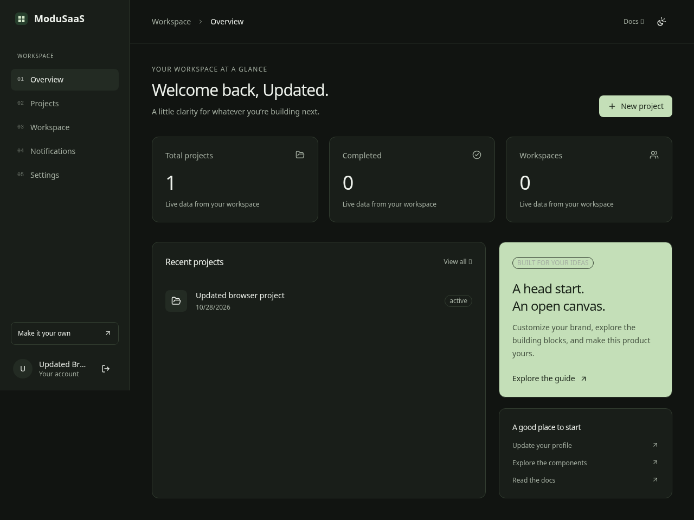

# ModuSaaS

An MIT-licensed, modular TypeScript SaaS foundation. Build your product on a reusable Next.js application with PostgreSQL, Better Auth, accessible UI, and authorized CRUD.

> Stop rebuilding the same infrastructure. Start building your actual product.

**Engineering preview.** See [implementation status](IMPLEMENTATION_STATUS.md) for verified behavior, limitations, and release gates. This repository does not claim production certification, a published npm package, or measured 95% token savings.



## Quick start

Requirements: Node 24 LTS (24.11+), pnpm 11.25, and PostgreSQL 17. Docker is optional; PostgreSQL is a separate required service.

```sh
corepack enable
corepack prepare pnpm@11.25.0 --activate
pnpm install --frozen-lockfile
# Start your own PostgreSQL, or use the optional Docker database:
docker compose -f compose.dev.yml up -d db
pnpm setup
pnpm dev
```

`setup` creates an ignored `.env` with a random auth secret, validates configuration, generates the Prisma client, and applies committed migrations. Review `DATABASE_URL` if your PostgreSQL uses another address. The default URL/password in `.env.example` is for local development only. Setup never seeds a shared account or password. `pnpm db:seed` is an explicit connection check without demo users.

Open the local application in your development environment, register, and create a project. No OAuth, payment, AI, Redis, or object-storage keys are needed. Without SMTP, registration signs in directly; email verification and recovery require SMTP. Use Mailpit to test email locally. Production deployments should configure SMTP before admitting users.

## What is included

- Next.js App Router modular monolith, React Server Components, strict TypeScript, Tailwind tokens and light/dark themes.
- Better Auth email/password, sessions, protected pages, profile/password changes, recovery, verification, optional Google/GitHub OAuth, account deletion guards.
- Individual and optional organization modes; owner/admin/member permissions enforced by Better Auth and resource services.
- Complete PostgreSQL project CRUD with validation, pagination, search, status filters, sorting, plan limits and cross-user/tenant authorization.
- shadcn Field primitives, Radix overlays/controls, React Hook Form examples, TanStack table and Recharts examples, development-only searchable gallery.
- Database-backed notifications and private local/S3 uploads.
- Optional Stripe checkout/portal/webhooks and AI SDK OpenAI/Anthropic/Google adapters, chat persistence, streaming, structured output and request quotas.
- Local scaffold generator, presets, migrations, Node/Docker deployment tooling, test suites and CI.

External adapters are real implementations but require configured providers. Live payment/AI/S3 validation is separate from fixture tests. Some requested advanced features remain unimplemented; consult status rather than treating this list as a release guarantee.

## Stack and layout

Node 24 · pnpm · Next.js 16 · React 19 · TypeScript · Tailwind 4 · Prisma 7 · PostgreSQL · Better Auth · Zod · React Hook Form · Radix/shadcn · Vitest · Playwright.

```text
src/app/             pages, layouts, API handlers
src/components/      UI, forms, layouts, data display
src/config/          branding, typed presets, server env validation
src/modules/         auth, projects, billing, AI, storage, email
src/server/          database, HTTP errors, CSRF, coordinated rate limits
prisma/              schema and committed SQL migrations
scripts/             setup and pinned engine-free Prisma tooling
tooling/             local generator and benchmark reporter
docs/                architecture, deployment and AI development recipes
```

## Commands

```sh
pnpm lint
pnpm typecheck
pnpm test
pnpm build
pnpm start
# With pnpm dev running and an isolated test database:
pnpm test:integration
pnpm test:e2e
pnpm test:generator
```

Playwright uses installed system Chromium when available, otherwise run `pnpm exec playwright install --with-deps chromium`. Integration tests exercise the standard preset with SMTP disabled; email tests use a dedicated Mailpit-enabled server. Test users/resources are isolated by unique names. Browser tests use account deletion for cleanup.

## Configuration and customization

Edit `src/config/app.ts` for brand, assets, typography, plans, languages, links and navigation. Edit `src/app/globals.css` for design tokens. Replace `public/logo.svg` and `public/favicon.svg`. Set `NEXT_PUBLIC_APP_NAME`, `NEXT_PUBLIC_APP_URL` and `NEXT_PUBLIC_PRESET` **before building**; public values are embedded into client bundles. Rebuild after changing them. Only English UI text is implemented; the language list is an extension point.

Copy `.env.example` for server/provider settings. Never put credentials in `NEXT_PUBLIC_*` variables. Never commit `.env`. Google/GitHub credentials enable their server-side providers; custom OAuth buttons can use `authClient.signIn.social`. Magic links and two-factor UI are not implemented.

Presets: `minimal` enables auth/database/dashboard/CRUD; `standard` adds teams and notifications; `full` adds billing/AI/storage. Email is independently configured. Presets gate routes and navigation; **all provider dependencies and source files are retained**. Heavy provider imports stay on the server. No Redis or background worker is required.

## Docker

```sh
# After generating/configuring .env with pnpm setup (a reachable database is required):
docker compose -f compose.dev.yml up --build
# Optional Mailpit:
docker compose -f compose.dev.yml --profile email up -d mailpit
# For a host Node app, set SMTP_HOST=localhost; for container app set SMTP_HOST=mailpit.
```

`compose.dev.yml` provides app + persistent database, with optional email/cache/storage profiles. The database is bound only to loopback. Development app source is baked into the image; rebuild after source changes. Redis and MinIO are optional infrastructure examples, not automatically connected modules. Create a private MinIO bucket and configure S3 variables explicitly.

Production: configure a URL-safe random `POSTGRES_PASSWORD`, random `BETTER_AUTH_SECRET`, public HTTPS `BETTER_AUTH_URL` and `NEXT_PUBLIC_APP_URL` in environment settings or an ignored `.env`. Never reuse development values.

```sh
docker compose -f compose.prod.yml up -d --build
```

The one-shot migration service must finish before the non-root standalone app starts. Place an HTTPS reverse proxy in front of the loopback-bound app. PostgreSQL has no published production port. Data and uploads use persistent volumes; back them up. See [deployment](docs/deployment/README.md) for provider settings, cloud proxy CA mounts, VPS/Vercel details and shutdown.

## Local generator

```sh
pnpm create-saas ../my-product --name "My Product" --package my-product --preset minimal --deployment node --database local
```

An interactive terminal without flags asks for choices. Existing targets are refused. The generator is local and has not been published to npm. Templates retain optional dependencies for a reproducible shared lockfile. See [generator](docs/getting-started/generator.md).

## Guides

- [Architecture and invariants](docs/architecture/decisions.md)
- [AI development recipes](docs/ai/recipes.md)
- [AI providers and usage](docs/modules/ai.md)
- [Billing, teams, email and files](docs/modules/README.md)
- [Deployment](docs/deployment/README.md)
- [Benchmark methodology](docs/ai/benchmark.md)
- [Release checklist](docs/release-checklist.md)

## Contribute

Read [CONTRIBUTING.md](CONTRIBUTING.md), [AGENTS.md](AGENTS.md), [security policy](SECURITY.md) and [code of conduct](CODE_OF_CONDUCT.md). Contributions are licensed under [MIT](LICENSE). Upstream notices are in [THIRD_PARTY_NOTICES.md](THIRD_PARTY_NOTICES.md).
